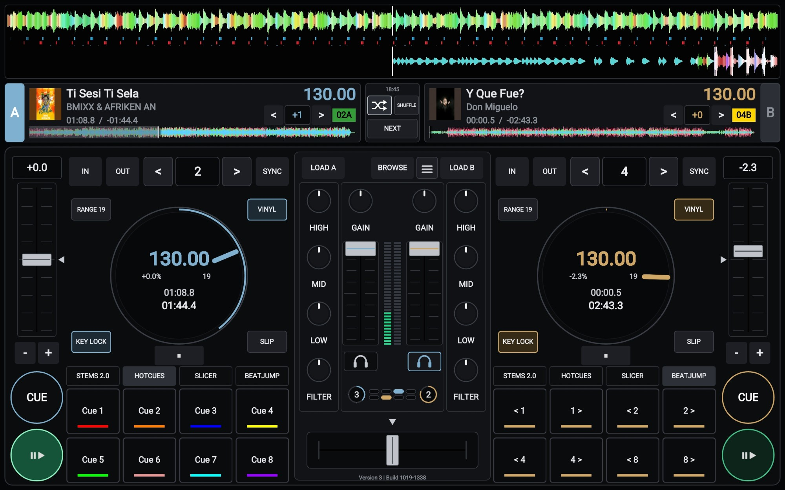

# VDJ Tablet Deck Skin

A two-deck, hardware-controller style skin for the **VirtualDJ Remote** app.



Unofficial. Not affiliated with or endorsed by Atomix Productions.

## Features

- Stacked colour waveforms with a beat-tick lane, and a song info strip per deck
- Jog discs, pitch faders, large CUE and PLAY
- Pad tabs: Hot Cues, Stems, Slicer, Beatjump, with SHIFT
- Loop controls, key shift, shared beat counter
- Mixer with EQ, filter and gain knobs, faders, PFL and crossfader
- Automix, shuffle and next, plus a menu for Sampler, Loop and Effects

## Install

1. Download the zip from [Releases](../../releases) and rename it to `VDJ Tablet Deck Skin.zip`. **Do not unzip it.**
2. Copy it into both folders:
   - `%LOCALAPPDATA%\VirtualDJ\RemoteSkins`
   - `%LOCALAPPDATA%\VirtualDJ\Skins`
3. Restart VirtualDJ, select the skin, and reconnect the Remote.

The bottom of the mixer shows the version and build, so you can tell which file is loaded.

## Versions

| Release | Notes |
|---|---|
| [v3.0.0](../../releases/tag/v3.0.0) | Current |
| [v2.0.0](../../releases/tag/v2.0.0) | With and without the beat-tick lane |
| [v1.0.0](../../releases/tag/v1.0.0) | First build |

Install one version at a time.

## Build from source

Requires Node.js 18 or newer.

```bash
npm ci
npm test
npm run build            # writes dist/VDJ Tablet Deck Skin v3.0.0.zip
npm run install:local    # also copies it into the Windows VirtualDJ folders
```

## Contributing

Please try it on your tablet and open an issue with your device, resolution and a screenshot. Bug reports and pull requests are welcome.

## License

Released under the [MIT License](LICENSE) ([what this means](https://opensource.org/license/mit)).
